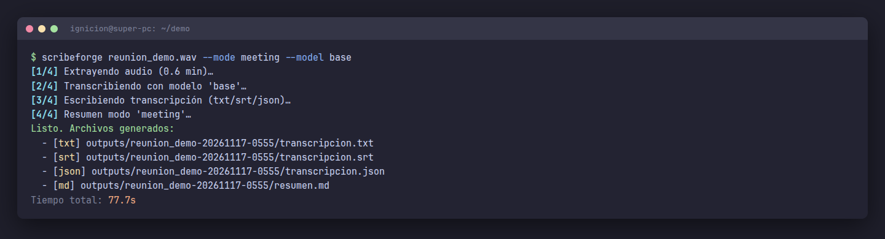
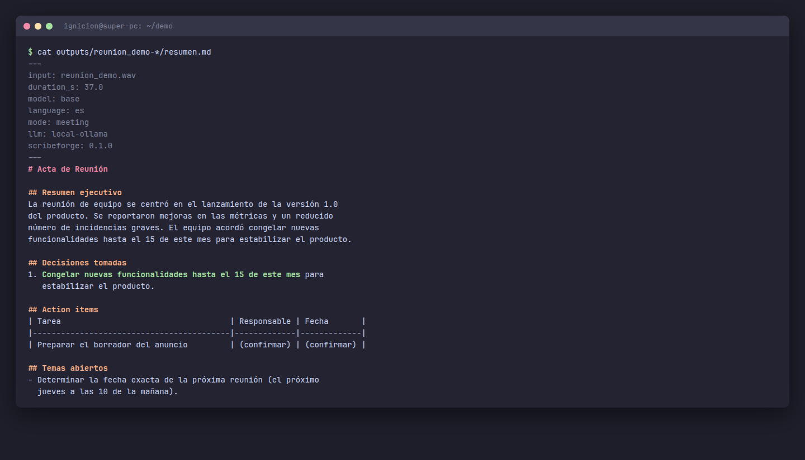

# ⚒️ ScribeForge-Local

> **Transcripción local con precisión quirúrgica + resúmenes LLM. Sin APIs de pago, sin muros de minutos.**

Utilidad CLI en Python para creadores, periodistas e investigadores: procesa audio/vídeo de **cualquier duración**, transcribe con [`faster-whisper`](https://github.com/SYSTRAN/faster-whisper) (CTranslate2) y genera actas, informes de entrevista o apuntes de clase con un LLM — local (Ollama/LM Studio) o híbrido (Groq).

## 🎬 Demo

**Pipeline completo en 4 pasos** (audio de 37 s, modelo `base`, CPU — 77 s de reloj):



**El resumen generado** (acta con front-matter auto-documentado, decisiones y action items):



<details>
<summary>Salida cruda del comando</summary>

```
$ scribeforge reunion_demo.wav --mode meeting --model base
[1/4] Extrayendo audio (0.6 min)…
[2/4] Transcribiendo con modelo 'base'…
[3/4] Escribiendo transcripción (txt/srt/json)…
[4/4] Resumen modo 'meeting'…
Listo. Archivos generados:
  - [txt] outputs/reunion_demo-20261117-0555/transcripcion.txt
  - [srt] outputs/reunion_demo-20261117-0555/transcripcion.srt
  - [json] outputs/reunion_demo-20261117-0555/transcripcion.json
  - [md] outputs/reunion_demo-20261117-0555/resumen.md
Tiempo total: 77.7s
```

</details>

## 🆚 Por qué no otra cosa

| | ScribeForge | APIs cloud (Whisper API, etc.) |
|---|---|---|
| Privacidad | 🔒 **Cero telemetría, cero red en transcripción** | tu audio sale de tu máquina |
| Duración | sin límites (bloques con solape >2 h) | muros de 25 min / facturación por minuto |
| Coste | 0 € (hardware propio + Ollama) | suscripción por minuto |
| Reanudación | ✅ caché por hash del archivo | ❌ se repaga cada reintento |
| Post-procesado | anti-alucinación, párrafos por pausas, SRT | suele devolver escombros seg a seg |

## 🚀 Quickstart (30 segundos)

```bash
# 1) venv + pip (no requiere sudo, funciona incluso con ensurepip deshabilitado)
python3 -m venv --without-pip .venv
curl -sSL https://bootstrap.pypa.io/get-pip.py | .venv/bin/python

# 2) dependencias + paquete
.venv/bin/pip install faster-whisper rich PyYAML pydantic
.venv/bin/pip install -e .

# 3) primer uso (descarga el modelo la primera vez)
.venv/bin/scribeforge audio.mp4 --mode meeting
```

Requisitos: **Python 3.10+**, `ffmpeg` en PATH, y para el resumen: Ollama/LM Studio o una API key (`SCRIBEFORGE_API_KEY`).

## 📦 Qué genera (por cada archivo)

| Archivo | Contenido |
|---|---|
| `transcripcion.txt` | texto limpio, párrafos reconstruidos por pausas reales del audio |
| `transcripcion.srt` | subtítulos con timestamps por segmento |
| `transcripcion.json` | segmentos crudos (start, end, text, no_speech_prob…) — material para post-proceso |
| `resumen.md` | acta/informe con **front-matter YAML** auto-documentado (modelo, idioma, llm usado, tiempos) |

El post-procesado anti-alucinación filtra por defecto: segmentos con `no_speech_prob > 0.6` o `avg_logprob < -1.0`, repeticiones consecutivas de Whisper, y basura tipo *"Subtítulos por la comunidad Amara.org"*.

## 🎛️ CLI de referencia

```
scribeforge <input> [opciones]

  --mode {interview,meeting,lecture}  perfil de resumen (default: meeting)
  --model <modelo>                    tiny|base|small|medium|large-v3 (default: auto → config)
  --device {auto,cpu,cuda}            dispositivo de inferencia
  --compute-type <t>                  int8|float16|… (auto según device)
  --language <es|en|…|auto>           ISO-639-1 o auto-detección
  --output <dir>                      raíz de salida (default: outputs/)
  --clean                             quita muletillas (mm, eh, este…) sin LLM
  --no-cache                          fuerza re-transcripción
  --keep-work                         conserva intermedios para depurar
  --dry-run                           plan (modelo, duración, rutas) sin ejecutar nada
  --config <ruta>                     config.yaml alternativa
  --debug                             traceback completo en error
```

**Códigos de salida:** `0` éxito · `2` entrada inválida/config · `3` sin ffmpeg · `4` LLM inaccesible · `130` cancelado (Ctrl+C mantiene lo ya escrito).

## ⚙️ config.yaml

Sin config, usa defaults razonables (Ollama local → Groq como fallback). Copia esta plantilla:

```yaml
model:
  size: small          # tiny|base|small|medium|large-v3
  device: auto         # auto|cpu|cuda
  language: auto       # o "es"

summary:
  mode: meeting        # interview|meeting|lecture
  context_chars: 24000
  timeout_s: 120

llm:
  endpoints:
    - name: local-ollama
      base_url: http://localhost:11434/v1
      model: qwen3:4b
    - name: groq                       # fallback si no hay Ollama
      base_url: https://api.groq.com/openai/v1
      model: llama-3.3-70b-versatile
      api_key_env: SCRIBEFORGE_API_KEY
```

La validación es all-at-once: una config ilegal imprime **todas** las violaciones con campo y valor esperado. Config ausente ≠ error: sigue con defaults aviso una vez.

## 🧠 Arquitectura

```
input ──▶ processor    (ffmpeg → WAV 16 kHz mono; bloques >2 h con solape de 2 s)
      ──▶ transcriber  (faster-whisper + VAD → anti-alucinación → caché durable)
      ──▶ summarizer   (chunker con solape + map-reduce, prompts en prompts/<modo>.md)
      ──▶ outputs/<src>-<timestamp>/{transcripcion.txt,.srt,.json, resumen.md}
```

- **Caché durable**: la transcripción se guarda por `(hash del input, modelo, idioma)` en `outputs/.cache/<hash>.json` — reprocesar un archivo solo cuesta el resumen. Vive **fuera** del workdir efímero (lección verificada en QA).
- **LLM resiliente**: timeouts, 2 reintentos backoff, fallback de endpoint, y sin API key salta al local con aviso — nunca aborta por eso.
- **Prompts como datos**: `scribeforge/prompts/*.md` editables sin tocar código.

## 🧪 Calidad

```bash
python3 -m unittest discover -s tests     # 30 smoke tests (stubs, sin red)
python3 tests/qa_fixture.py               # 16 checks end-to-end (ffmpeg real + stubs)
```

Los smoke tests no necesitan modelo ni conexión: chunker, párrafos, SRT, config y fallback de LLM son funciones puras. La fixture Q/A genera un WAV real con ffmpeg y valida las 4 salidas, exit codes y el caché (2ª pasada → 0 llamadas al transcriber).

**Verificado en máquina real** (CPU, Python 3.14, modelo `tiny`): clip con voz de 11 s transcrito 100 % correcto en CPU, resumen generado vía Ollama `qwen3:4b` local. Tono puro sin voz → 0 segmentos (el VAD no alucina).

## 🔧 Solución de problemas

| Síntoma | Solución |
|---|---|
| `TypeError: open() got an unexpected keyword argument 'metadata_errors'` | PyAV ≥ 14 vs faster-whisper ≤ 1.2.1 — ScribeForge ya lo esquiva con un shim interno; si sale igual, `pip install pyav==13.1.0` (requiere `apt install libavformat-dev`) |
| `/tmp` sin espacio (`Disk quota exceeded`) | tmpfs compartido y saturado; usa `--output` fuera de /tmp |
| pip ausente / `ensurepip is disabled` | venv `--without-pip` + `get-pip.py` (ver quickstart) |
| `ffmpeg no encontrado` | `sudo apt install ffmpeg` |
| Resumen omitido "AVISO" | Ollama apagado o API key sin valor — el pipeline NO falla: entrega transcripción y avisó por pantalla |

## 🗺️ Backlog explícito (v1 sin esto a propósito)

Diarización de hablantes (pyannote) · panel web Streamlit · export VTT/ASS · watch-folder · `BatchedInferencePipeline` (~8× GPU).

## 📋 Estado

v0.1.0 — software local, cero telemetría, sin dependencias de pago obligatorias.
